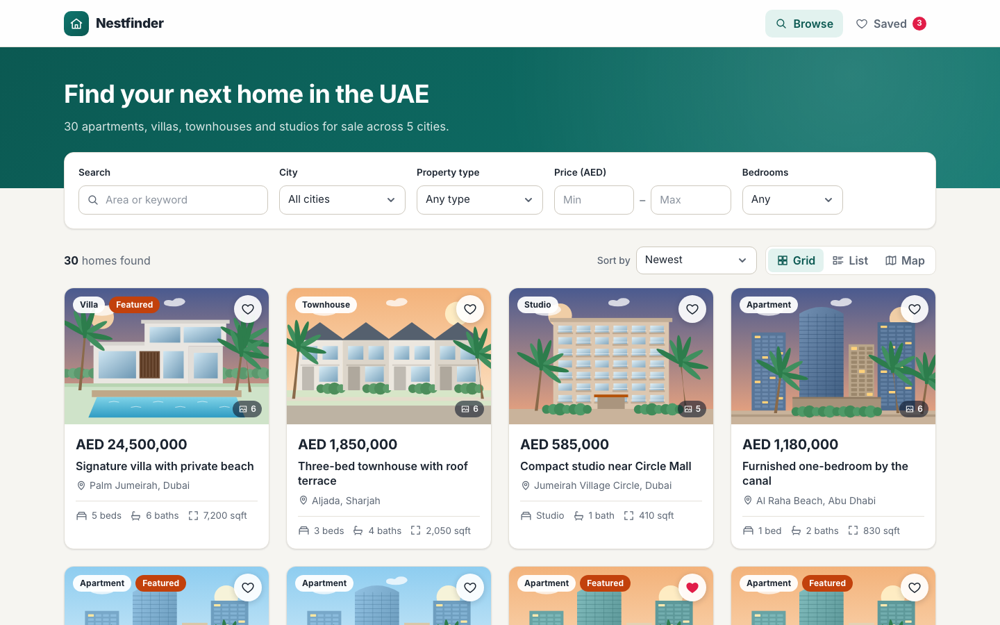
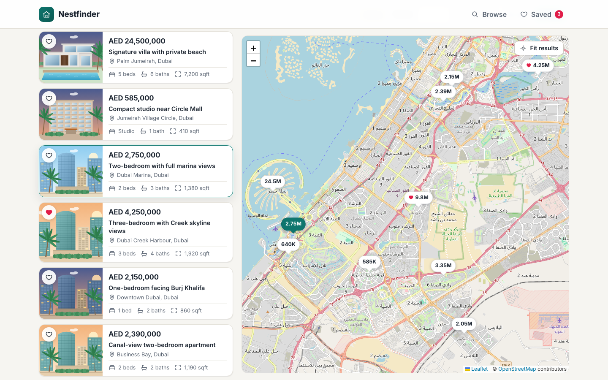
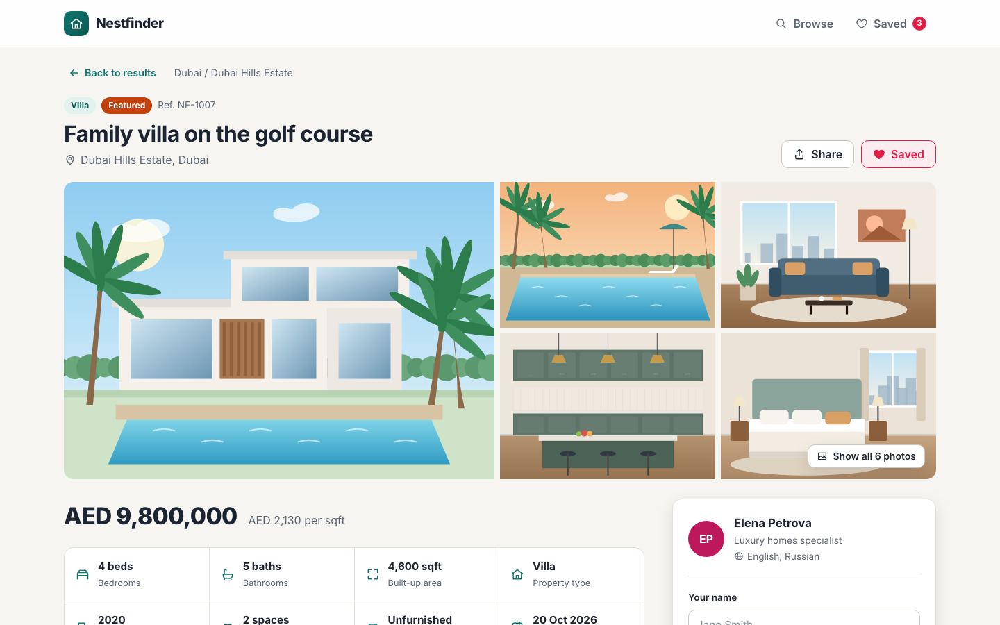
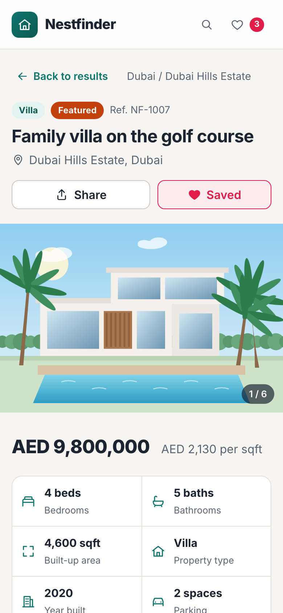

# Real Estate Listings

A property search app built with Angular 21 and Leaflet: browse homes for sale with filters that live in the URL, switch between a grid, a list and a map, open a listing with a photo gallery and contact the agent.

**[Live Demo](https://hkhodkar.github.io/real-estate-listings/)**



| Map view | Property details |
| --- | --- |
|  |  |

<p align="center"></p>

## Features

- **Listings grid and list** - 30 demo homes (apartments, villas, townhouses and studios) across Dubai, Abu Dhabi, Sharjah, Ajman and Ras Al Khaimah, with price, bedrooms, bathrooms, area and price per sqft
- **Filters in the URL** - search, city, property type, price range and bedrooms are query params (`/?city=dubai&type=villa&minPrice=5000000&sort=price-asc`), so any search can be bookmarked or shared, survives a reload and works with the back button
- **Sorting** - newest, price (low to high, high to low) and largest first
- **Map view** - [Leaflet](https://leafletjs.com/) with OpenStreetMap tiles, price markers that turn into dots when zoomed out, popup cards that link to the listing, and the map zooms to fit the filtered results. Hovering a card highlights its marker, clicking a marker scrolls to its card
- **Property page** - photo gallery with a full-screen lightbox (keyboard arrows, swipe on touch screens, thumbnails), key facts, amenities, a location mini-map and similar homes in the same city
- **Contact the agent** - typed reactive form with validation and a success state (the demo doesn't send anything)
- **Favorites** - save homes from any card or the property page; they are stored in `localStorage`, synced between open tabs and listed on their own page, with undo for removals
- **Responsive** - collapsible filters, a swipeable gallery and a stacked map layout on phones
- **Bundled illustrations** - every listing photo is a small SVG drawn for this project, so there are no external images or licensing questions

## Tech Stack

- [Angular 21](https://angular.dev) - standalone components, signals and `computed`, new control flow, zoneless change detection, OnPush everywhere, `inject()`
- Lazy-loaded routes with component input binding for route params
- Typed reactive forms
- [Leaflet](https://leafletjs.com/) + OpenStreetMap tiles
- SCSS with CSS custom properties (no UI library)
- [Vitest](https://vitest.dev/) for unit tests
- GitHub Actions + GitHub Pages for deployment

## Getting Started

Requirements: Node.js 20.19+ or 22.12+ and npm.

```bash
git clone https://github.com/hkhodkar/real-estate-listings.git
cd real-estate-listings
npm install
npm start
```

Then open http://localhost:4200.

Other useful commands:

```bash
npm test -- --watch=false   # run unit tests
npm run build               # production build in dist/
```

### Leaflet marker icons

Leaflet finds its default marker images through a path in its CSS, which breaks once the CSS is bundled and the file names are hashed. `angular.json` copies the images from `node_modules/leaflet/dist/images` to `/leaflet`, and `core/map/leaflet.ts` points `L.Icon.Default` at them with relative URLs, so the icons work with any `--base-href` (the GitHub Pages build uses `/real-estate-listings/`). The price markers on the big map are `divIcon`s styled in `styles/_map.scss`.

## Project Structure

```
src/
├── app/
│   ├── core/
│   │   ├── data/          # demo listings, cities and agents
│   │   ├── map/           # Leaflet setup (default icon paths, tiles)
│   │   ├── models/        # Listing, Agent, City and filter types
│   │   ├── services/      # listings, favorites store, toasts, scroll position memory
│   │   └── utils/         # filtering, sorting, URL params and formatting (unit tested)
│   ├── features/
│   │   ├── listings/      # listings page, filter bar and map view
│   │   ├── property/      # property page, gallery, lightbox, mini-map and contact form
│   │   ├── favorites/     # saved homes
│   │   └── not-found/
│   ├── shared/
│   │   ├── pipes/         # price, area, beds and date formatting
│   │   └── ui/            # listing card, favorite button, icons, confirm dialog, toasts
│   ├── app.routes.ts      # lazy-loaded routes
│   └── app.ts             # app shell with header and footer
├── styles/                # theme variables, base styles, buttons, form fields, map overrides
public/
└── images/                # SVG listing illustrations
```

## Author

**Hatef Khodkar** - [github.com/hkhodkar](https://github.com/hkhodkar)

## License

[MIT](LICENSE)
